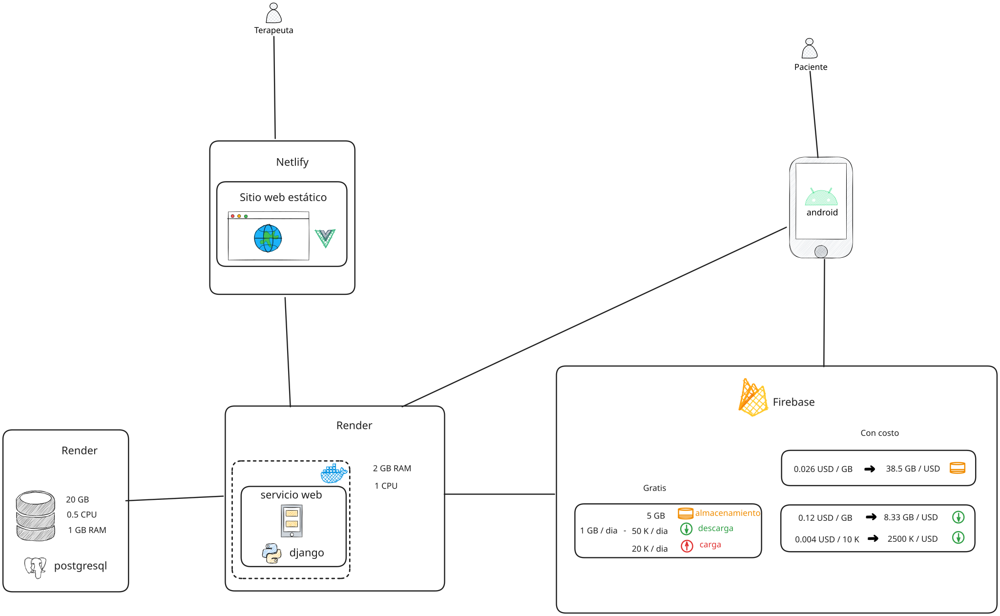
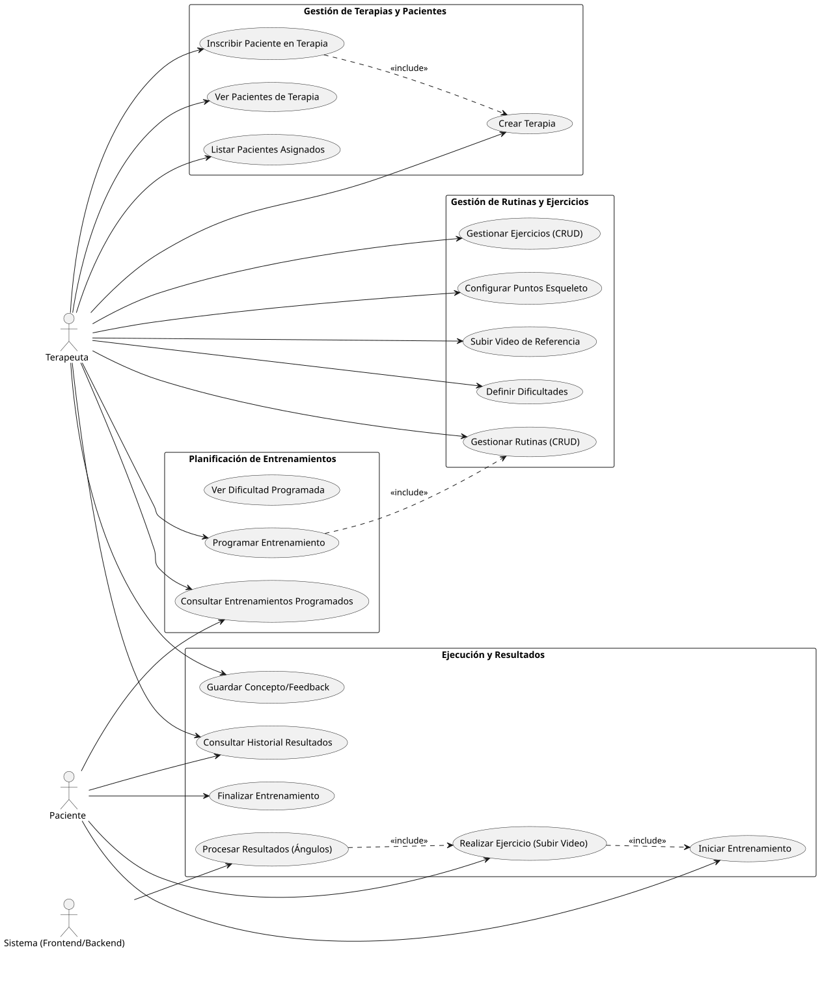
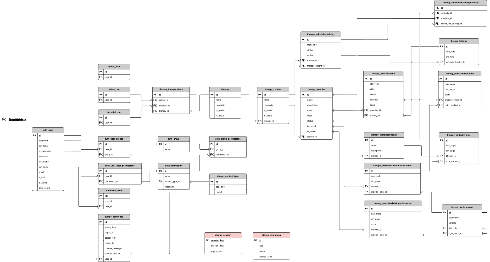
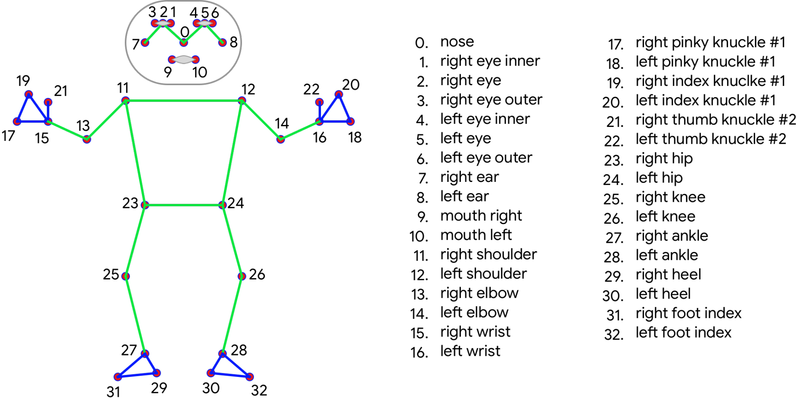

# Telerehabilitación API

Esta API es el backend para una plataforma de telerehabilitación física. Permite a los terapeutas gestionar pacientes,
crear rutinas de ejercicios personalizadas y realizar un seguimiento del progreso mediante el análisis de video. Los
pacientes pueden consultar sus entrenamientos programados, realizar ejercicios y recibir retroalimentación automática
sobre su ejecución.

## Esta versión

Copia propia del backend original, integrada con el Servicio de Procesamiento
del trabajo de grado de telefisioterapia (Universidad Antonio Nariño, grupo
LACSER/Bioingeniería): los ángulos articulares de los videos de referencia y
de los pacientes los calcula el servicio con MediaPipe y los devuelve por
webhook.

- Decisiones de diseño, reglas y contrato con el servicio:
  [`docs/DECISIONES_TECNICAS.md`](docs/DECISIONES_TECNICAS.md).
- Planes de trabajo, hallazgos de la plataforma original y significado de
  los códigos que citan los comentarios: también en `docs/DECISIONES_TECNICAS.md`.

**Repositorios relacionados:**

| Repositorio | Qué es |
|---|---|
| [`telefisioterapia-panel`](https://github.com/davidgarcia05042-netizen/telefisioterapia-panel) | Panel web del terapeuta (Vue 3) |
| [`telefisioterapia-app`](https://github.com/davidgarcia05042-netizen/telefisioterapia-app) | App Android del paciente |
| [`servicio-procesamiento-pose`](https://github.com/davidgarcia05042-netizen/servicio-procesamiento-pose) | Servicio de Procesamiento (FastAPI + Celery, MediaPipe) |
| [`entorno-pruebas`](https://github.com/davidgarcia05042-netizen/entorno-pruebas) | Comparación de modelos de pose contra gold standard de laboratorio |
| [`pose-benchmark`](https://github.com/davidgarcia05042-netizen/pose-benchmark) | Tiempo, CPU y memoria de cada modelo |

## Repositorio original

Análisis del repositorio original:

* > <a href="https://gitingest.com/santivarelaagent-cmd/telerehabilitacion_be" target="_blank">GIT INGEST</a>

Documentación a profundidad del repositorio original:

* > <a href="https://deepwiki.com/santivarelaagent-cmd/telerehabilitacion_be" target="_blank">DEEP WIKI</a>

## Arquitectura



## Casos de uso



## Esquema DB

* > <a href="ER.svg" target="_blank">Diagrama ER</a>



## ESQUELETO MEDIAPIPE



* > [LIBRO PY](https://aprendepython.es/core/introduction/)

## Dependecias

```code
asgiref
certifi
chardet
coreapi
coreschema
Django
django-cors-headers
django-environ
djangorestframework
drf-yasg
gevent
grequests
gunicorn
idna
inflection
itypes
Jinja2
MarkupSafe
openapi-codec
packaging
psycopg2
pyparsing
pytz
requests
ruamel.yaml
ruamel.yaml.clib
simplejson
six
sqlparse
uritemplate
urllib3
zope.event
zope.interface
```

